<a href="#see-it-in-action">
  <picture>
    <source media="(prefers-color-scheme: dark)" srcset="docs/banner-dark.svg" />
    <source media="(prefers-color-scheme: light)" srcset="docs/banner-light.svg" />
    
  </picture>
</a>

<p align="center">
  
  
  
  
  
  
  
  
  <a href="LICENSE"></a>
</p>

<p align="center">
  <a href="#see-it-in-action"><b>Demo</b></a> &nbsp;·&nbsp;
  <a href="#highlights"><b>Highlights</b></a> &nbsp;·&nbsp;
  <a href="#screenshots"><b>Screenshots</b></a> &nbsp;·&nbsp;
  <a href="#how-it-works"><b>How it works</b></a> &nbsp;·&nbsp;
  <a href="#getting-started"><b>Getting started</b></a> &nbsp;·&nbsp;
  <a href="#api-endpoints"><b>API</b></a>
</p>

> [!NOTE]
> **Portfolio / university project.** Data is stored in JSON files and the admin login (`admin` / `admin`) is a demo, so keep it on `localhost`. See [Known limitations](#known-limitations).

**Lumière Cinema** is a full-stack cinema booking system. Customers browse the repertoire, pick a screening and choose seats on a live seat map; the booking is confirmed with a reservation number. Behind a separate login, an admin panel manages films, screenings and reservations and shows an audit log of everything that happened.

The backend is a **Spring Boot REST API** with a classic controller → service → repository structure. Every booking is validated on the server (seat range, duplicates, double booking) and a new screening is rejected if it **overlaps another one in the same room**, counting the film's length plus a 15-minute buffer. Data is persisted to **JSON files with atomic writes**, so the app runs with no database to install. The frontend is **plain JavaScript (ES modules) served by Vite**, in a dark, gold-accented "premium cinema" theme.

The name is a nod to the **Lumière brothers**, pioneers of cinema; the visual style was inspired by the game **[Expedition 33](https://expedition33.com/)**.

<p align="center"><b>Keywords</b></p>

<table align="center">
  <tr>
    <td align="right" valign="middle"><sub><b>Backend</b></sub></td>
    <td>
      
      
      
      
      
    </td>
  </tr>
  <tr>
    <td align="right" valign="middle"><sub><b>Frontend</b></sub></td>
    <td>
      
      
      
      
      
    </td>
  </tr>
  <tr>
    <td align="right" valign="middle"><sub><b>Architecture</b></sub></td>
    <td>
      
      
      
      
      
    </td>
  </tr>
  <tr>
    <td align="right" valign="middle"><sub><b>Domain</b></sub></td>
    <td>
      
      
      
      
    </td>
  </tr>
  <tr>
    <td align="right" valign="middle"><sub><b>UI&nbsp;/&nbsp;UX</b></sub></td>
    <td>
      
      
      
    </td>
  </tr>
</table>

## See it in action

<p align="center">
  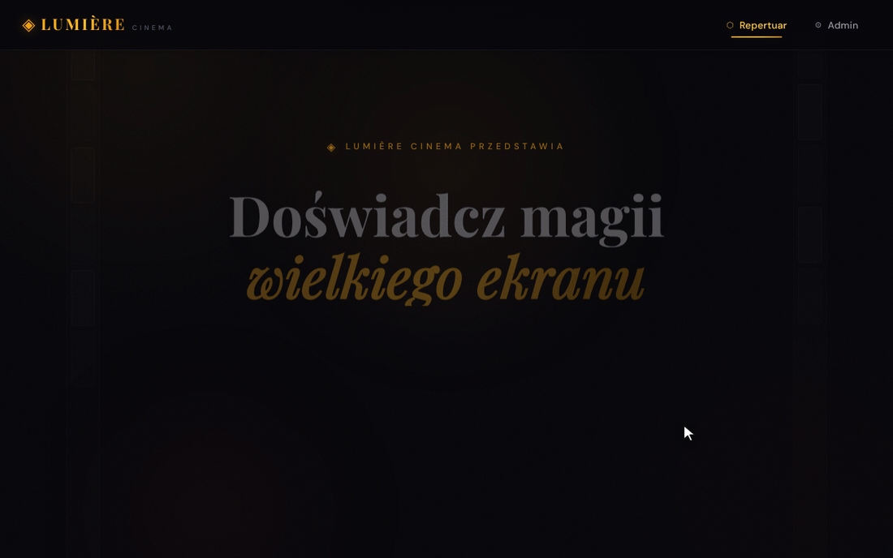
</p>

<p align="center"><sub>Landing page → <em>Teraz gramy</em> → Interstellar → pick a screening → seats 47 and 48 (taken seats can't be clicked) → <em>Zarezerwuj</em> → confirmation #12.</sub></p>

<details>
<summary><b>Admin panel in action</b> (login, rejected overlapping screening, audit log)</summary>
<br />

<p align="center">
  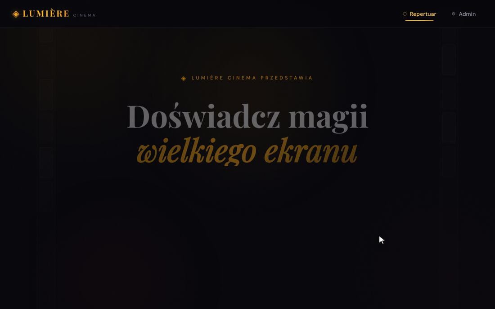
</p>

<p align="center"><sub>Login → <em>Seanse</em> → Oppenheimer at 22:00 in Sala 1 is rejected (Interstellar runs until ~00:04) → a free evening works → <em>Logi</em>.</sub></p>

</details>

## Highlights

<table>
  <tr>
    <td width="33%" valign="top">
      <br />
      <b>Cinematic UI</b><br />
      <sub>Full-screen hero with spotlights and film strips, poster cards with a golden glow, Playfair Display + DM Sans, smooth entrance animations.</sub>
    </td>
    <td width="33%" valign="top">
      <br />
      <b>Live seat map</b><br />
      <sub>Seat grid sized to the room, availability loaded from the API, click to select, running summary and a button that counts your tickets.</sub>
    </td>
    <td width="33%" valign="top">
      <br />
      <b>Server-side validation</b><br />
      <sub>Screening must exist, seats must be in range, no duplicates and no double booking. Clear Polish error messages end up in a toast.</sub>
    </td>
  </tr>
  <tr>
    <td width="33%" valign="top">
      <br />
      <b>No double-booked rooms</b><br />
      <sub>A new screening is rejected if it overlaps another one in the same room (film length + 15 min buffer). Screenings in the past are rejected too.</sub>
    </td>
    <td width="33%" valign="top">
      <br />
      <b>No database needed</b><br />
      <sub>Films, screenings and reservations live in JSON files. Each save writes a <code>.tmp</code> file and moves it into place, and a corrupted file is set aside instead of crashing the app.</sub>
    </td>
    <td width="33%" valign="top">
      <br />
      <b>Admin panel</b><br />
      <sub>Four tabs: films (add / delete), screenings (schedule / delete), reservations (cancel) and logs. Customers never see admin forms.</sub>
    </td>
  </tr>
  <tr>
    <td width="33%" valign="top">
      <br />
      <b>Audit log</b><br />
      <sub>Every change (new film, screening, reservation, cancellation) is written with a timestamp to <code>log.txt</code> and readable in the admin panel.</sub>
    </td>
    <td width="33%" valign="top">
      <br />
      <b>Responsive</b><br />
      <sub>Works on desktop and phones, with a hamburger menu and a two-column poster grid on small screens.</sub>
    </td>
    <td width="33%" valign="top">
      <br />
      <b>Runs out of the box</b><br />
      <sub>Maven Wrapper included, and on first start the <code>DataSeeder</code> creates 2 rooms, 8 films and 30 screenings over the next 5 days.</sub>
    </td>
  </tr>
</table>

## Screenshots

<p align="center">
  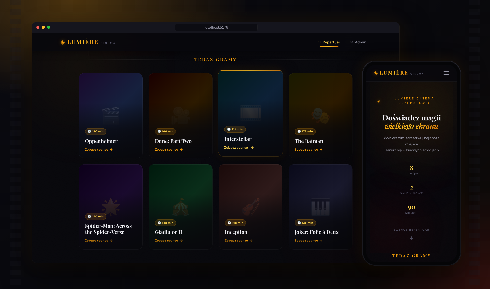
</p>

<table>
  <tr>
    <td width="50%" valign="top">
      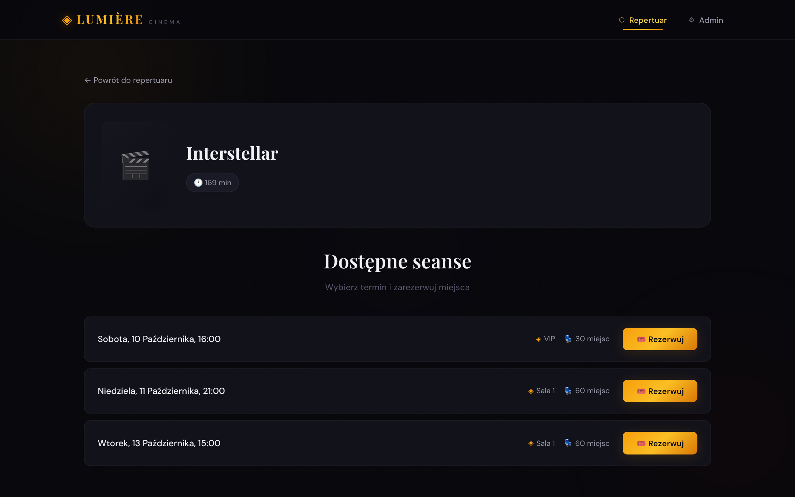
      <p align="center"><b>Pick a screening</b><br /><sub>Upcoming showtimes for the film, sorted by date, with room and capacity.</sub></p>
    </td>
    <td width="50%" valign="top">
      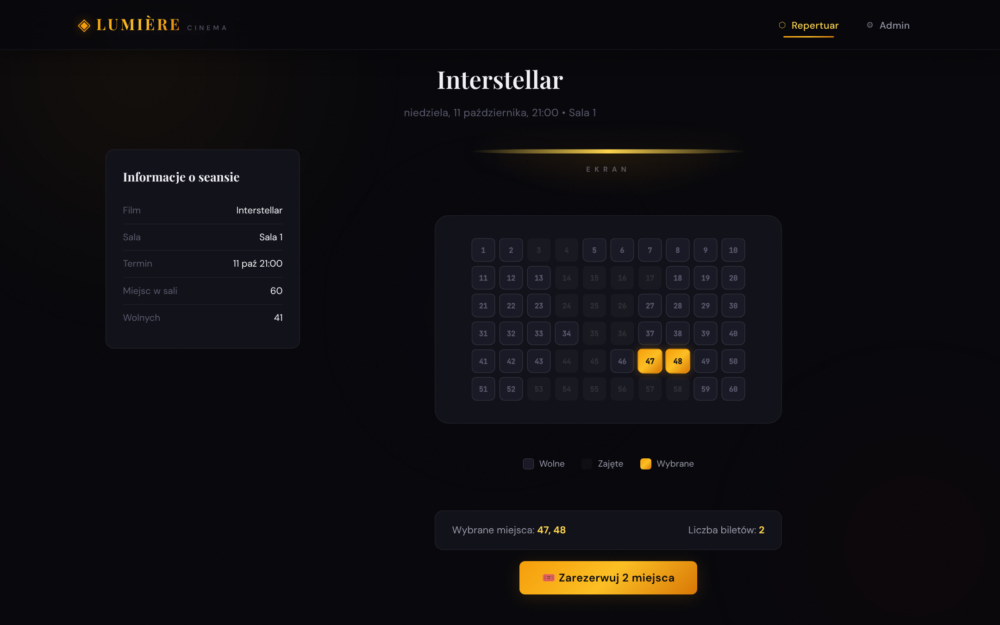
      <p align="center"><b>Choose your seats</b><br /><sub>Taken seats are dimmed; the summary and the button update as you click.</sub></p>
    </td>
  </tr>
  <tr>
    <td width="50%" valign="top">
      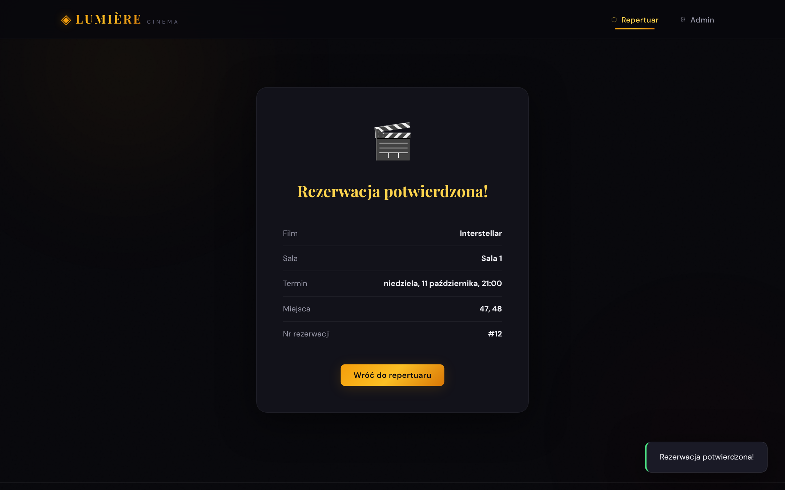
      <p align="center"><b>Booking confirmed</b><br /><sub>Film, room, date, seats and the reservation number.</sub></p>
    </td>
    <td width="50%" valign="top">
      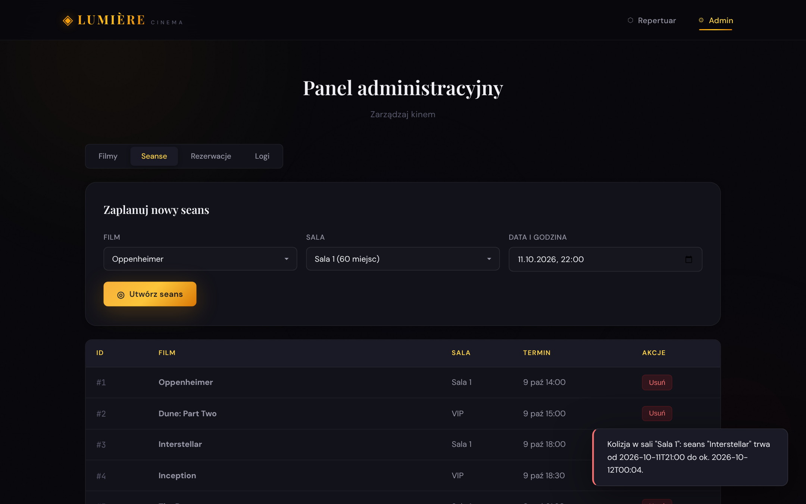
      <p align="center"><b>Scheduling with conflict detection</b><br /><sub>The backend refuses a screening that would overlap Interstellar in Sala 1.</sub></p>
    </td>
  </tr>
</table>

<details>
<summary><b>More screens</b> (landing page, admin tabs, login, mobile)</summary>
<br />

| Landing page | Repertoire |
|:---:|:---:|
| 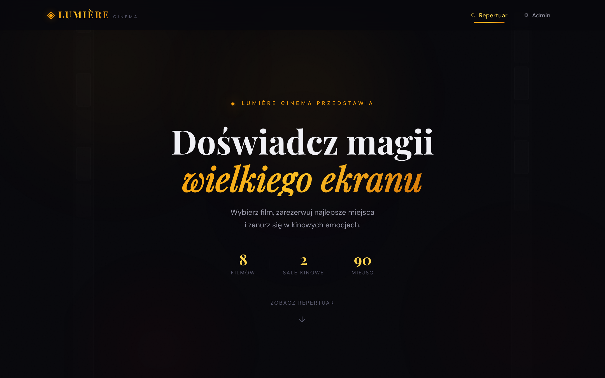 | 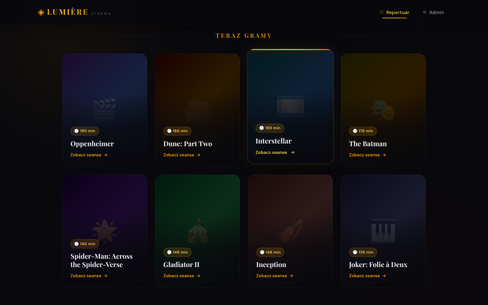 |
| **Admin: films** | **Admin: reservations** |
| 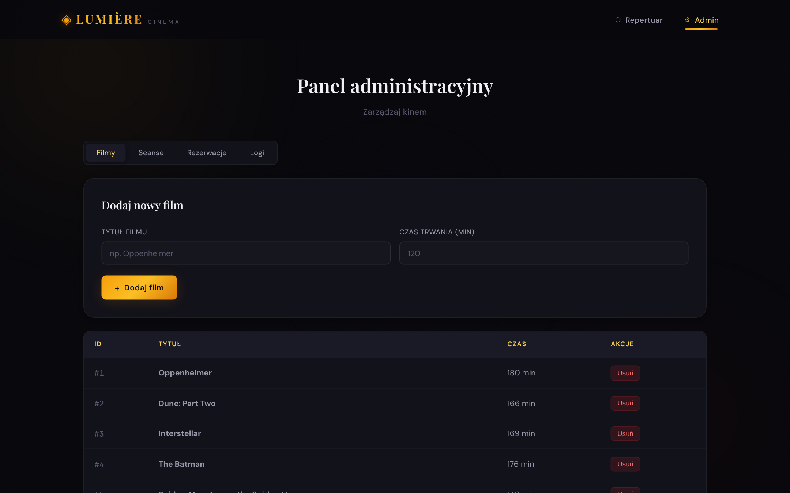 | 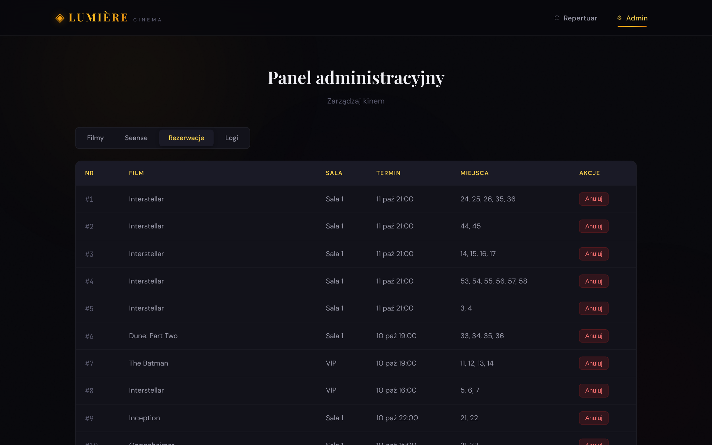 |
| **Admin: audit log** | **Admin login** |
| 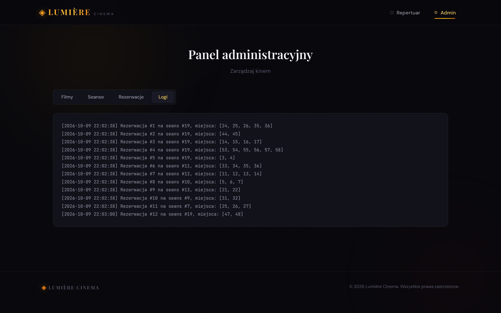 | 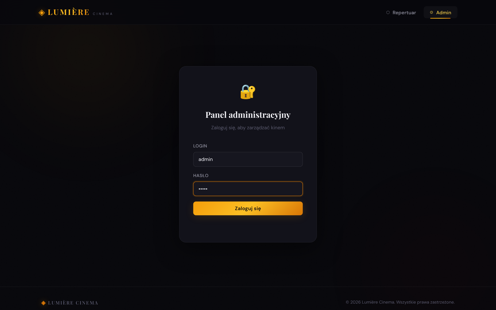 |

<p align="center">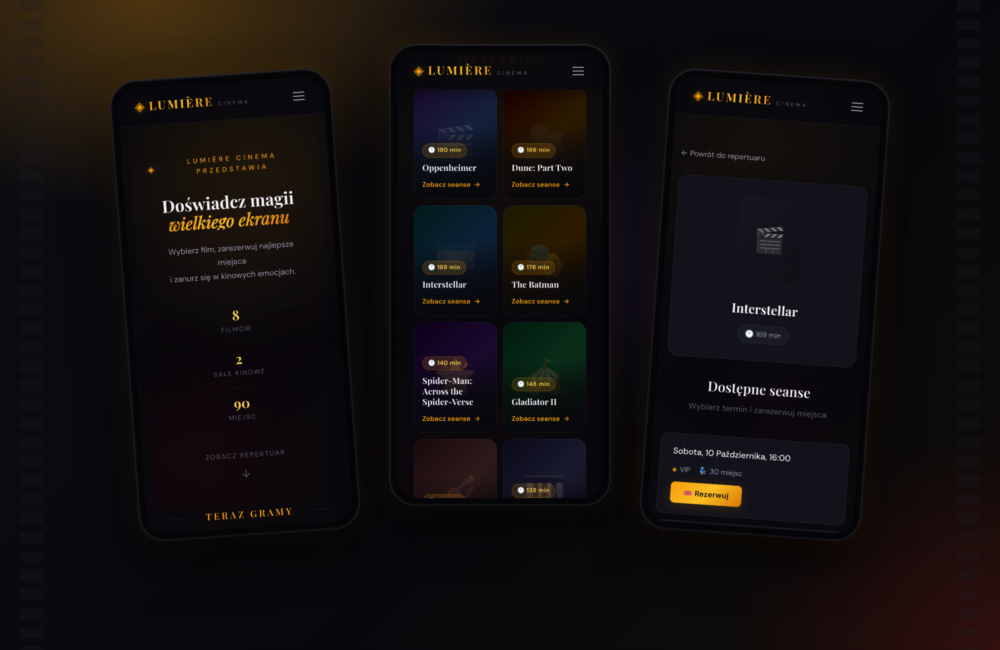</p>

</details>

<sub>Screenshots and GIFs come from the real app (Spring Boot backend + Vite frontend) running locally with the seeded data.</sub>

## How it works

<picture>
  <source media="(prefers-color-scheme: dark)" srcset="docs/pipeline-dark.svg" />
  <source media="(prefers-color-scheme: light)" srcset="docs/pipeline-light.svg" />
  
</picture>

### User flow

```
Repertoire  →  Pick a film  →  See screenings  →  Select seats  →  Booking confirmation
```

The customer only sees the movie grid, the screening list and the seat picker. All management happens in the admin panel behind a separate login.

### One booking

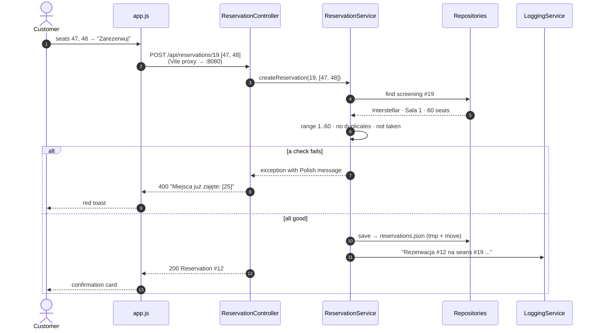

### Architecture

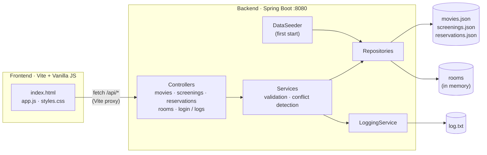

### Domain model

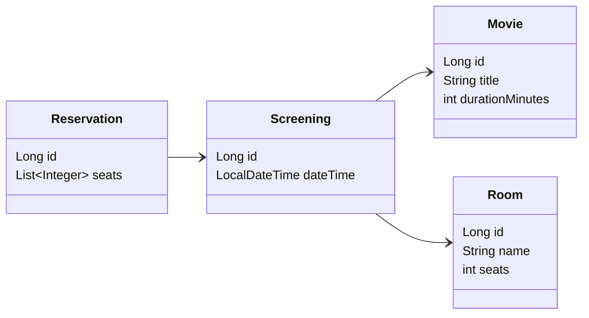

Seats are numbered `1..room.seats`. A screening "occupies" its room from `dateTime` until `dateTime + durationMinutes + 15 min`.

### Room conflict detection

<picture>
  <source media="(prefers-color-scheme: dark)" srcset="docs/conflict-dark.svg" />
  <source media="(prefers-color-scheme: light)" srcset="docs/conflict-light.svg" />
  
</picture>

`ScreeningService.createScreening` loads the film and the room, then compares the new time slot with every screening in the same room. Two slots overlap when `newStart < existingEnd && newEnd > existingStart`. On a conflict the API answers `400` with the name of the colliding film and its time range, which the admin panel shows as a toast.

### Try the API from a terminal

<p align="center">
  
</p>

<sub>All responses above are real output of the running backend.</sub>

## Tech Stack

| Layer | Technology |
|-------|-----------|
| Backend | Java 17+, Spring Boot 3.2 (`spring-boot-starter-web`), embedded Tomcat |
| Serialization | Jackson (`jackson-databind`, `jackson-datatype-jsr310` for `LocalDateTime`) |
| Persistence | JSON files (`movies.json`, `screenings.json`, `reservations.json`), atomic write via temp file + move |
| Build | Maven (wrapper included, no install needed) |
| Frontend | HTML5, CSS3 (custom properties, animations), vanilla JavaScript (ES modules), Fetch API |
| Dev server | Vite 6 (dev server + `/api` proxy to `:8080`) |
| Fonts | Playfair Display, DM Sans, JetBrains Mono (Google Fonts) |

## Project Structure

```
Cinema_Booking_System/
├── backend/
│   ├── pom.xml
│   ├── mvnw / mvnw.cmd             # Maven Wrapper
│   └── src/
│       ├── cinema/
│       │   ├── CinemaApplication.java
│       │   ├── CorsConfig.java     # CORS for the Vite dev server
│       │   ├── controller/         # REST endpoints (/api/...)
│       │   ├── model/              # Movie, Room, Screening, Reservation
│       │   ├── repository/         # JSON-file repos, DataSeeder
│       │   └── service/            # validation, conflicts, logging
│       └── resources/
│           └── application.properties
├── frontend/
│   ├── index.html                  # all views in one page
│   ├── vite.config.js              # port 5178, /api proxy
│   └── src/
│       ├── css/styles.css          # "Lumière" theme
│       └── js/app.js               # views, API calls, seat map, admin
├── docs/                           # README images, GIFs, SVGs
├── LICENSE
└── README.md
```

## Getting Started

### Prerequisites

- **Java 17** or newer
- **Node.js 18+** and npm
- Maven is **not** required, the project ships the Maven Wrapper

### Backend

```bash
cd backend
.\mvnw.cmd spring-boot:run      # Windows
./mvnw spring-boot:run          # Linux / macOS
```

The API starts at `http://localhost:8080`. Data files (`movies.json`, `screenings.json`, `reservations.json`, `log.txt`) are created in the directory you start the backend from.

> [!TIP]
> **Fresh data with current dates.** The seeder only runs when the files are empty or missing, and screenings in the past are hidden. To get 30 screenings starting today, stop the backend, delete `movies.json`, `screenings.json` and `reservations.json` from `backend/`, and start it again.

### Frontend

```bash
cd frontend
npm install
npm run dev
```

Open `http://localhost:5178`. Requests to `/api/*` are proxied to the backend, so there is nothing else to configure.

### Default credentials

| Username | Password |
|----------|----------|
| `admin` | `admin` |

## Seeded Data

On first start `DataSeeder` creates:

| Entity | Count | Details |
|--------|:-----:|---------|
| Rooms | 2 | Sala 1 (60 seats), VIP (30 seats) |
| Films | 8 | Oppenheimer (180 min), Dune: Part Two (166), Interstellar (169), The Batman (176), Spider-Man: Across the Spider-Verse (140), Gladiator II (148), Inception (148), Joker: Folie à Deux (138) |
| Screenings | 30 | Today and the next 4 days, 4 to 8 per day, in both rooms |

## API Endpoints

<details>
<summary><b>All endpoints</b></summary>

Errors are returned as `400 Bad Request` with a plain-text Polish message (shown in the UI as a toast), missing resources as `404`.

### Movies
| Method | Endpoint | Description |
|--------|----------|-------------|
| `GET` | `/api/movies` | List all films |
| `GET` | `/api/movies/{id}` | Get a film |
| `POST` | `/api/movies` | Add a film `{"title": "...", "durationMinutes": 120}` |
| `PUT` | `/api/movies/{id}` | Update title and/or duration |
| `DELETE` | `/api/movies/{id}` | Delete a film |

### Screenings
| Method | Endpoint | Description |
|--------|----------|-------------|
| `GET` | `/api/screenings` | List all screenings |
| `GET` | `/api/screenings/{id}` | Get a screening |
| `GET` | `/api/screenings/movie/{movieId}` | Upcoming screenings of a film, sorted by date |
| `GET` | `/api/screenings/{id}/availability` | Free seat numbers |
| `POST` | `/api/screenings` | Create `{"movie":{"id":1},"room":{"id":1},"dateTime":"2026-10-11T22:00"}` (checks the past and room conflicts) |
| `DELETE` | `/api/screenings/{id}` | Delete a screening |

### Reservations
| Method | Endpoint | Description |
|--------|----------|-------------|
| `GET` | `/api/reservations` | List all reservations |
| `GET` | `/api/reservations/{screeningId}` | Reservations for a screening |
| `GET` | `/api/reservations/{screeningId}/available` | Free seat numbers (same as `availability`) |
| `POST` | `/api/reservations/{screeningId}` | Book seats, body: `[47, 48]` |
| `DELETE` | `/api/reservations/{id}` | Cancel a reservation |

### Rooms
| Method | Endpoint | Description |
|--------|----------|-------------|
| `GET` | `/api/rooms` | List rooms |
| `POST` | `/api/rooms` | Add a room `{"name": "...", "seats": 40}` (kept in memory only) |

### Admin / misc
| Method | Endpoint | Description |
|--------|----------|-------------|
| `POST` | `/api/login` | Check credentials `{"username","password"}` (SHA-256), returns `"OK"` or `401` |
| `GET` | `/api/logs` | Contents of `log.txt` |
| `GET` | `/api/test` | Health check |

</details>

## Configuration

<details>
<summary><b>Ports and settings</b></summary>

| Setting | Where | Default |
|---------|-------|---------|
| Backend port | `backend/src/resources/application.properties` → `server.port` | `8080` |
| Frontend port | `frontend/vite.config.js` → `server.port` | `5178` |
| API proxy | `frontend/vite.config.js` → `server.proxy['/api']` | `http://localhost:8080` |
| CORS origins | `CorsConfig.java` | `localhost` / `127.0.0.1` on `5178` and `5179` |
| Screening buffer | `ScreeningService.createScreening` | 15 min after each film |
| Log file | `LoggingService.LOG_FILE` | `log.txt` |

</details>

## Known limitations

<details>
<summary><b>What a production version would change</b></summary>
<br />

- **Authentication is a demo.** The admin login is checked in the browser (SHA-256 of the password) and the admin endpoints have no auth, so anyone who can reach the API can change data. `POST /api/login` exists on the backend but the UI does not use it yet. A real version would use Spring Security with sessions or JWT.
- **Rooms live in memory.** They are recreated by the seeder on every start; rooms added with `POST /api/rooms` disappear after a restart.
- **JSON files, single process.** Repositories keep data in lists and rewrite the whole file on each change, with no locking. Good for a demo, not for concurrent users; a database with a unique constraint on (screening, seat) would be the next step.
- **Deleting a film** does not remove its screenings or reservations.
- **Small phones:** the 60-seat grid of Sala 1 is wider than a 390 px screen, so the seat page scrolls sideways there.

</details>

## Acknowledgments

- Partially built using **vibe coding**, an AI-assisted development approach where parts of the codebase were generated and iterated on through natural-language conversation.
- Fonts: [Playfair Display](https://fonts.google.com/specimen/Playfair+Display), [DM Sans](https://fonts.google.com/specimen/DM+Sans), [JetBrains Mono](https://fonts.google.com/specimen/JetBrains+Mono)
- Icons in this README: [Lucide](https://lucide.dev) (ISC license)

## License

This project is available under the [MIT License](LICENSE).

## Contact

**Grzegorz Sienkiewicz**
✉️ gsienkiewicz03@gmail.com
🐙 GitHub: [@Nurek54](https://github.com/Nurek54)
